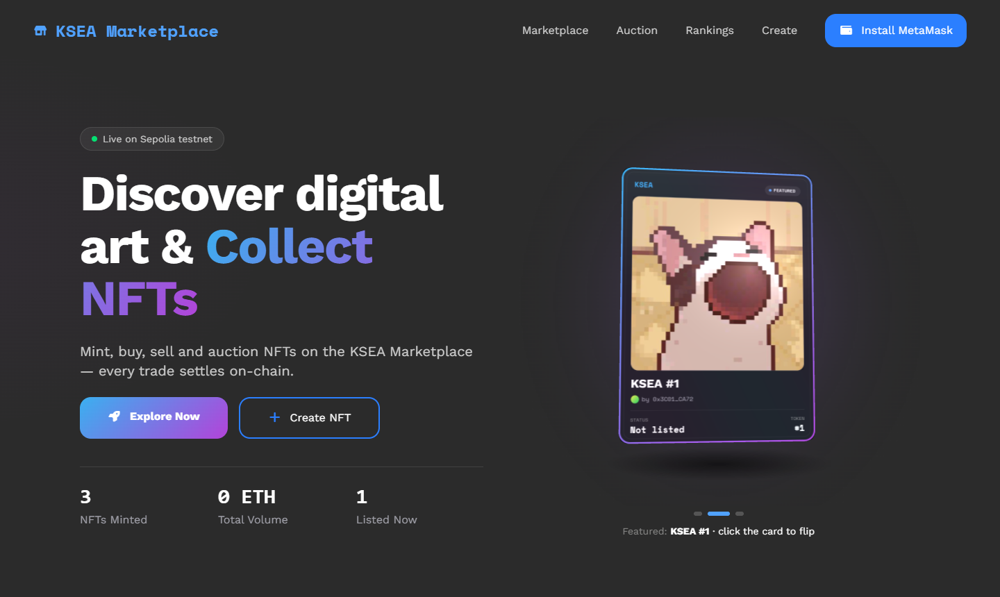
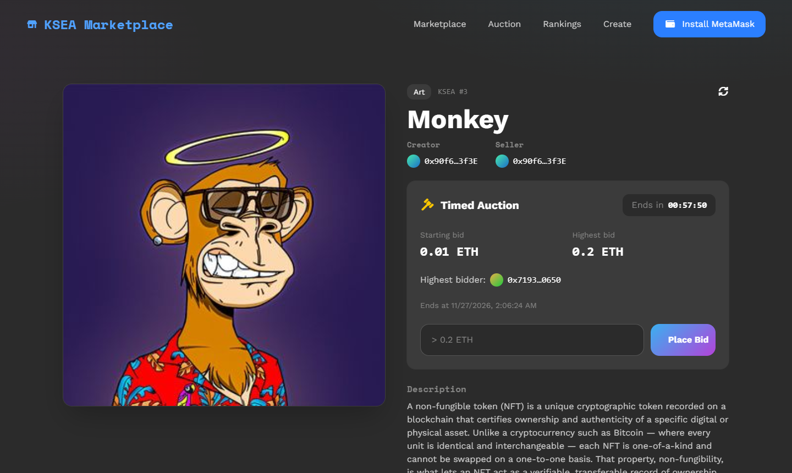
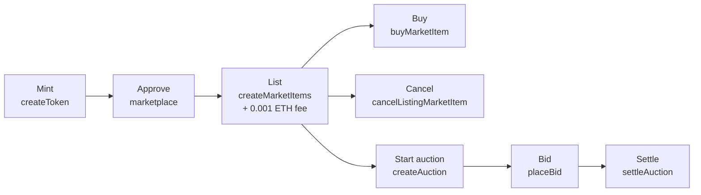

<h1 align="center">🎨 Decentralized NFT Marketplace</h1>
<h3 align="center">A Full-Stack Web3 DApp for Minting, Trading, and Bidding on NFTs</h3>

<p align="center">
  
  
  
  
</p>

---

## 📖 About The Project

This project is a decentralized Non-Fungible Token (NFT) marketplace built on Ethereum. It provides a trustless environment for users to create (mint), list, buy, and bid on digital assets. The platform leverages optimized smart contracts and decentralized storage to ensure absolute true ownership and immutability.

*Note: The frontend is currently under active development.*

## ✨ Key Features

* **Optimized ERC-721 Smart Contracts:** Secure and gas-efficient implementation of the ERC-721 non-fungible token standard.
* **Bidding & Auction System:** Built-in support for users to place bids on listed NFTs, allowing dynamic price discovery.
* **Decentralized Storage:** Metadata and digital assets are securely stored off-chain using **IPFS**, ensuring no single point of failure.
* **Modern Frontend:** A responsive user interface built with React and Vite for lightning-fast performance and seamless Web3 wallet integration. (processing 🛠️)

## 🛠️ Tech Stack

### Smart Contracts (Backend)
* **Language:** Solidity
* **Framework:** Foundry (Development & Testing)
* **Standards:** ERC-721

### Client (Frontend)
* **Framework:** React.js + Vite
* **Web3 Integration:** Ethers.js / Web3.js
* **Storage:** IPFS (InterPlanetary File System)
# KSEA NFT Marketplace

A decentralized NFT marketplace on the Ethereum **Sepolia** testnet. Mint ERC-721 tokens, sell them at a fixed price or in timed auctions, buy, bid and settle — every trade happens on-chain, with no backend.

**Live demo:** nft-marketplace-one-iota.vercel.app &nbsp;·&nbsp; **Network:** Sepolia (testnet ETH only)



## Features

- **Mint NFTs** with a name, description, category and custom properties. Images and metadata are uploaded to IPFS through Pinata; without a Pinata key, you paste an image URL and the metadata is stored on-chain as a data URI.
- **Fixed-price sales**: list, buy and cancel. Listing costs 0.001 ETH and the marketplace keeps 2% of each sale.
- **Timed auctions** (up to 12 hours): start an auction on a listing, place bids, withdraw your ETH when outbid, and settle when time is up. Anyone can settle.
- **Browse**: search, filter by category and status, sort by price, see rankings of top creators and collectors, and open profile pages with Owned / Created / On Sale tabs.
- **Admin panel**: the marketplace owner can withdraw collected fees from their profile page.
- **Wallet**: connects to MetaMask and switches to Sepolia automatically. All data is readable without a wallet through a public RPC.
- **Interface**: a 3D holographic card in the hero (Three.js, drawn entirely in code with no image assets), scroll reveals and card tilt. All motion turns off when the OS "reduce motion" setting is on.



## Tech stack

| Layer | Tools |
|---|---|
| Smart contracts | Solidity 0.8.30, Foundry, OpenZeppelin (ERC-721, ReentrancyGuard), Chainlink Automation interface |
| Frontend | React 19, Vite 7, React Router 7, Tailwind CSS 4, ethers.js 6, Three.js |
| Storage | IPFS via Pinata |
| Hosting | Vercel (frontend), Sepolia (contracts) |

## Deployed contracts (Sepolia)

| Contract | Address |
|---|---|
| `KSeaNFT` (ERC-721) | [`0x061668d46d4cd5e8b99baf8e18b9cff6c348d95c`](https://sepolia.etherscan.io/address/0x061668d46d4cd5e8b99baf8e18b9cff6c348d95c) |
| `KSeaNFTMarketplace` | [`0x16b64458f52eecd8b4a1d61c747678a9ada21c55`](https://sepolia.etherscan.io/address/0x16b64458f52eecd8b4a1d61c747678a9ada21c55) |
| `AuctionModular` | [`0x178793ec0531188365663063e9e2d27c4f466ad0`](https://sepolia.etherscan.io/address/0x178793ec0531188365663063e9e2d27c4f466ad0) |

Listing fee 0.001 ETH · sale fee 2% · maximum auction length 12 hours (set in [`contract/src/Constant.sol`](contract/src/Constant.sol)).

## How it works



- While an NFT is listed, the marketplace contract holds it in escrow. On a sale the seller receives the price minus the 2% fee.
- An outbid bidder gets their ETH back by calling `refundBid` from the NFT page. Settling an auction sends the NFT to the highest bidder and pays the seller.
- The frontend reads everything straight from the contracts (`getAllNfts`, `getAuction`, `ownerOf`, `tokenURI`). There is no indexer or database.
- To show who created each NFT, the app scans the NFT contract's mint events in chunks of 49,000 blocks (the public RPC limit) and caches the result in `localStorage`.

## Project structure

```
├── contract/             Foundry project
│   ├── src/              KSeaNFT, KSeaNFTMarketplace, extension/Auction
│   ├── script/           deploy scripts
│   └── test/             unit and integration tests
├── src/
│   ├── config/           contract addresses, ABIs, categories
│   ├── context/          wallet, marketplace data, notifications
│   ├── hooks/            transactions, rankings, UI effects
│   ├── lib/              chain reads, IPFS, formatting, error messages
│   ├── three/            3D hero card (generated textures and scene)
│   ├── components/       UI components
│   └── pages/            one file per route
├── docs/                 screenshots used in this README
└── vercel.json           sends every route to index.html
```

## Run locally

You need Node.js 20.19+ (or 22.12+), the MetaMask extension, and some Sepolia ETH from a faucet.

```bash
git clone https://github.com/b1endong/NFT-Marketplace.git
cd NFT-Marketplace
npm install
cp .env.example .env   # optional, see below
npm run dev
```

Then open http://localhost:5173. Other scripts: `npm run build`, `npm run preview`, `npm run lint`.

### Environment variables

All variables are optional; the app runs on the defaults.

| Variable | Purpose | Default |
|---|---|---|
| `VITE_PINATA_JWT` | Upload images and metadata to IPFS from the Create page | Not set: paste an image URL, metadata stored on-chain |
| `VITE_IPFS_GATEWAY` | Preferred IPFS gateway, e.g. `https://<name>.mypinata.cloud/ipfs/` | Public gateways |
| `VITE_RPC_URL` | Sepolia RPC used for reads | `https://ethereum-sepolia-rpc.publicnode.com` |
| `VITE_NFT_ADDRESS`, `VITE_MARKETPLACE_ADDRESS`, `VITE_AUCTION_ADDRESS` | Use your own deployment | Addresses in the table above |
| `VITE_NFT_DEPLOY_BLOCK` | First block to scan for mint events | `9096185` |

> [!WARNING]
> Vite builds `VITE_*` variables into the JavaScript sent to the browser, so anyone can read them. Give the Pinata key only the `pinFileToIPFS` and `pinJSONToIPFS` permissions.

> [!NOTE]
> Alchemy's free tier limits `eth_getLogs` to 10 blocks per request, which breaks the creator lookup. Keep the default RPC or use a provider that allows ranges of 50,000 blocks.

## Deploy to Vercel

1. Import the repository on Vercel. The Vite preset works as is (build command `npm run build`, output directory `dist`).
2. Add any environment variables under **Project Settings → Environment Variables**, then redeploy. Vite reads them at build time, so a change only takes effect after a new build.
3. [`vercel.json`](vercel.json) rewrites every path to `index.html`, so routes such as `/marketplace` or `/nft/...` load correctly when opened directly or refreshed.

## Smart contracts

```bash
cd contract
git submodule update --init --recursive   # OpenZeppelin and Chainlink libraries
forge build
forge test
```

Deploy with the `makefile`:

```bash
# Local Anvil node (http://localhost:8545)
make deployNFT
make deployMarketplace

# Sepolia: set SEPOLIA_RPC_URL, ETHERSCAN_API_KEY and ACCOUNT (a cast wallet name) in contract/.env
make deployNFT ARGS="--network sepolia"
make deployMarketplace ARGS="--network sepolia"
```

`deployMarketplace` deploys both the marketplace and the auction module. After a new deployment, put the new addresses (and the NFT deploy block) in the `VITE_*` variables.

## Known limitations

This is a learning project on a testnet. **Do not use it with real funds.**

- `KSeaNFTMarketplace.transferNftToWinner` has no access check: the `onlyAuctionModule` modifier exists but is not applied. Any address can take an NFT that is held in escrow. The fix requires redeploying the contracts.
- `buyMarketItem` still works while an auction is running. The UI hides the Buy button during auctions, but a direct contract call gets around that.
- In `AuctionModular`, bidding again after being outbid adds the old bid to the new one. `checkUpkeep` and `getAllAuctions` loop over the wrong keys, so Chainlink Automation will not settle auctions; settle them from the NFT page instead.
